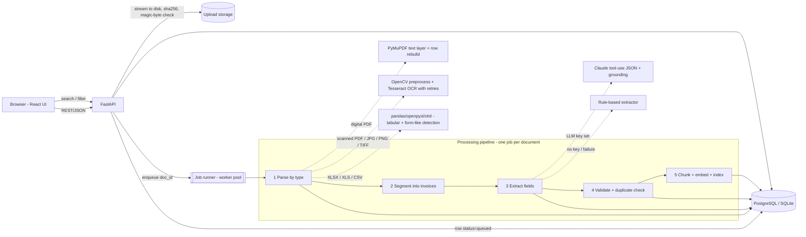
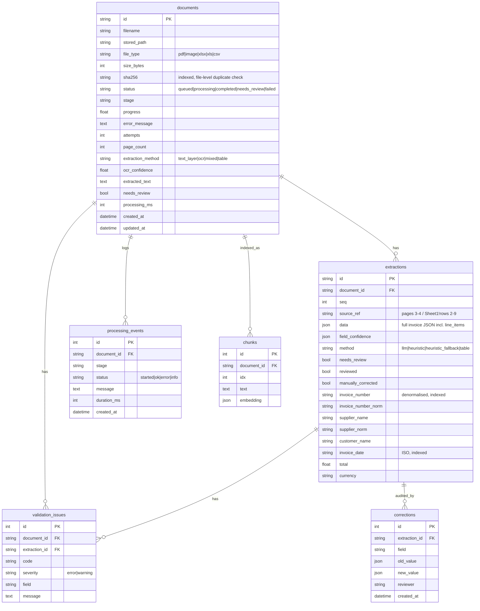

# Architecture

## 1. System diagram


## 2. Request lifecycle
1. `POST /api/documents` (multi-file) streams each file to disk (size-capped), computes SHA-256, detects the real type from **magic bytes** (a renamed `.exe` is rejected), inserts a `documents` row (`queued`) and enqueues the id. Returns `202` immediately.
2. A worker runs `services.process_document`: stage + progress are written to the DB after every step (UI polls `/status`).
3. Every failure ends in `status=failed` with a readable `error_message` and a `processing_events` row - nothing is lost silently. `POST /reprocess` / `/reprocess-failed` re-queue.
4. On startup `recover_pending()` re-queues anything left `queued`/`processing` by a crash.

## 3. Key design decisions (and alternatives considered)
| Decision | Why | Trade-off / upgrade path |
|---|---|---|
| **FastAPI (Python)** instead of NestJS | OCR, pandas and PDF libs are Python-native; one language for API + pipeline | Suggested stack lists Node/NestJS; this is an allowed alternative |
| **In-process worker pool, state in DB** instead of Redis/BullMQ | Zero-infrastructure start, jobs are durable because state lives in the DB and are recovered after restart | Single node only. `jobs.enqueue()` is the one seam: replace body with Celery/RQ `send_task` to scale workers horizontally (documented, not implemented) |
| **PostgreSQL** (SQLite for dev/tests) | Same SQLAlchemy models; JSON columns for structured results | PG path is written to be portable but **was not run in the build sandbox** |
| **Embeddings stored as JSON, cosine in NumPy** instead of a vector DB | Works on any DB with no extension; fine up to ~100k chunks | Swap `chunks.embedding` for a `pgvector` column + `ORDER BY embedding <=> :q` for large corpora |
| **Hash embeddings by default**, `sentence-transformers` optional | Deterministic, no model download, fast | Hash embeddings are mostly lexical (+ small synonym map); set `EMBEDDING_PROVIDER=sbert` for true semantic search |
| **LLM optional with grounding**, rule-based fallback | System keeps working without keys/quota; hallucinated strings are removed | Rule-based path needs conventional labels |
| **Streaming page-by-page PDF processing** | A 1000-page PDF never holds more than one page image in memory | see `BENCHMARK_LARGE.md` |
| **Validator is deterministic code, not the LLM** | Arithmetic must be auditable and repeatable | - |

## 4. Database schema

Indexes: `documents(status, file_type, sha256, needs_review, created_at)`, `extractions(invoice_number, supplier_name, invoice_date, (supplier_norm, invoice_number_norm))`, FKs on every child table.

## 5. Extraction JSON (returned by `/results`)
```json
{
  "invoice_number": "INV-2024-0012", "invoice_date": "2024-03-15",
  "supplier_name": "ACME Industrial Supplies Ltd", "customer_name": "Beta Holdings Inc",
  "subtotal": 925.0, "tax": 92.5, "total": 1017.5, "currency": "USD",
  "line_items": [{"description": "Hydraulic pump", "quantity": 2, "unit_price": 450.0, "amount": 900.0}]
}
```
Missing values are `null` (never guessed). `field_confidence` holds 0-1 per field.

## 6. Validation rules (`backend/app/validation.py`)
| Code | Severity | Rule |
|---|---|---|
| `MISSING_FIELD` | error (invoice no., date, supplier, total) / warning (customer, currency) | required field absent |
| `NO_LINE_ITEMS` | warning (forces review) | nothing extracted |
| `INVALID_NUMBER`, `NEGATIVE_AMOUNT` | error / warning | NaN, non-numeric, negative |
| `INVALID_DATE`, `FUTURE_DATE`, `OLD_DATE`, `AMBIGUOUS_DATE` | error / warning | impossible, future, <2000, dd/mm vs mm/dd |
| `INVALID_CURRENCY` | warning | not an ISO-4217 code in the supported list |
| `LINE_ITEM_MISMATCH` | error | qty x unit price != amount (±0.02) |
| `SUBTOTAL_MISMATCH` | error | sum(line amounts) != subtotal (±0.02) |
| `TOTAL_MISMATCH` | error | subtotal + tax != total (±0.02); or lines + tax != total when no subtotal |
| `TOTAL_BELOW_SUBTOTAL`, `TAX_RATE_SUSPICIOUS` | error / warning | total < subtotal; tax > 50 % of subtotal |
| `DUPLICATE_INVOICE` | error | same supplier + invoice number in an earlier document (any format) |
| `DUPLICATE_FILE` | warning | byte-identical file uploaded before |
| `LOW_CONFIDENCE`, `LOW_OCR_CONFIDENCE` | warning (forces review) | field confidence < 0.6 / OCR mean confidence < 60 |

A document is `needs_review` if any error or any "forces review" warning exists. A reviewer can correct fields (re-validates, audit-logged) or approve as-is.
Tolerance is an **absolute** 0.02: a relative tolerance was tried first and hid a 20.00 error on a 9,900 invoice (caught by tests).

## 7. Security
- Optional `X-API-Key` (constant-time compare); CORS allow-list; files stored under random UUID names (no path traversal), original name sanitised.
- Magic-byte type check, per-file size cap, files-per-request cap, image decompression-bomb guard, PDF password/corruption handled.
- LLM prompt-injection hardening (forced tool call, grounding). SQL via SQLAlchemy parameters only.
- Not included (recommend at deployment): TLS termination, per-user auth/RBAC, rate limiting at the proxy, virus scanning, encryption at rest.

## 8. Scalability & performance
- API returns in milliseconds; heavy work is off the request path. Page-streaming keeps memory flat.
- OCR only runs on pages without a text layer; Tesseract is pinned to 1 thread per process (`OMP_THREAD_LIMIT=1`) and parallelised across documents.
- Scale-out path: Postgres + N API replicas + Celery workers on a shared volume/S3 + pgvector.
